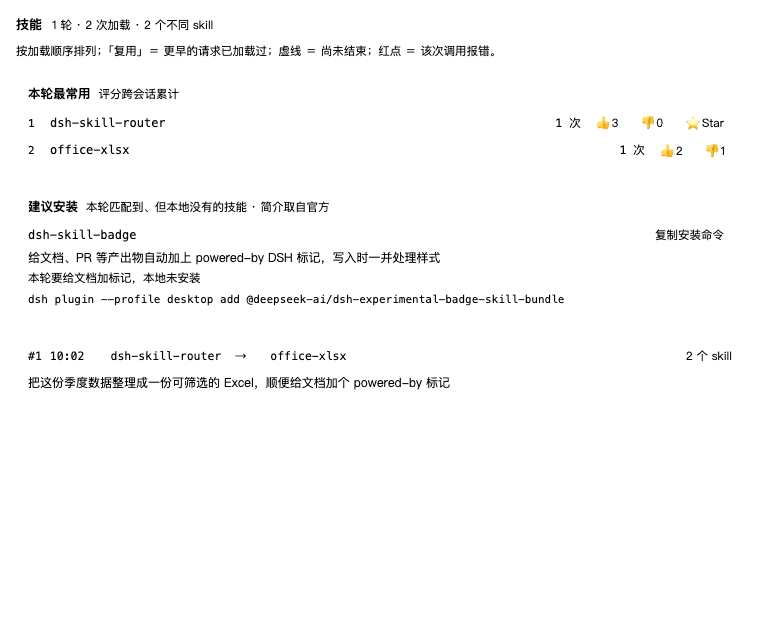
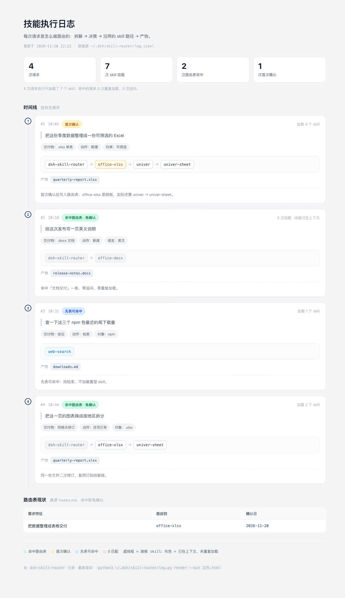

# dsh-skill-router

[English](README.md) | [简体中文](README.zh-CN.md) | **日本語** | [한국어](README.ko.md)

> **このタスクは、どのスキルに任せるべきか。** 一度だけ判断し、その結論を覚え、通った道筋を見えるようにします。

[DeepSeek Harness](https://github.com/deepseek-ai/deepseek-harness)（DSH）にスキルが増えすぎて、誰も全部は把握できません。初心者はどれを使えばいいか分からず、慣れた人でも「選んだスキルが本当に解決したのか」を確かめられません。

このバンドルはその判断を明示的な手順にします — 分解し、照合し、一度だけ確認し、以後は再利用 — さらに会話ページに**スキル**ビューを置いて、通った道筋を可視化します。

[`dsh-plugin`](https://github.com/topics/dsh-plugin) エコシステムの一部です — スキル、パネル、インストーラを 1 つのバンドルに。

## 収録内容

| 部分 | 役割 |
|---|---|
| `skills/dsh-skill-router/SKILL.md` | ルーティング規則：要求を分解し、スキルを照合し、一度確認し、対応表を書き、経路を記録 |
| `client.js` | 会話ページの**スキル**ビュー：1 ターン 1 カードで実際に読み込んだ経路を表示、上部に使用回数トップ 5 と 👍 / 👎 評価 |
| `assets/` | `routes.md` テンプレートと `log.py`。初回インストール時に `$DSH_HOME/skill-router/` へ複製（既存は上書きしない） |
| `index.js` | ホスト側：`ctx.skills.registerProvider` でスキルを公開し、状態ディレクトリを初期化 |

## デモ

**スキルビュー** — 会話ページの「軌跡」「コンテキスト」の隣に並びます。1 ターン 1 カード、経路はタイトル行、上部にセッション内の多用スキル 5 件と累計評価。*（サンプルデータで描画）*



**実行ログ** — `log.py render` が `log.jsonl` を単体ページに変換します。各要求、その判断、読み込んだスキル、成果物まで。*（サンプルデータ）*



## ルーティングの流れ

1. **分解** — 成果物、対象、動作、制約、規模、そして選択を変えうる唯一の曖昧点。
2. **照合** — 3 つの関門（その成果物を作れるか、前提条件は揃うか、禁止されていないか）を通し、強 / 中 / 弱に格付け。弱い候補は提示しません。
3. **一度だけ確認** — 同じ種類の要求の初回のみ。
4. **対応表に記録** — `$DSH_HOME/skill-router/routes.md` に「向かない用途」の境界も書き、後で誤発動しないようにします。
5. **再利用** — 同種の要求はそのままスキルへ。説明は一行、質問はなし。

## インストール

DSH `0.2.2` が必要です。**[最新リリースを取得](https://github.com/renzg/dsh-skill-router/releases/latest)**（`dsh-skill-router-0.5.1.tgz`）してから：

```bash
dsh plugin --profile desktop add dsh-skill-router-0.5.1.tgz
```

npm から入れる場合：`dsh plugin --profile desktop add @zhiyu.pub/dsh-skill-router`

**設定 → プラグイン → プラグインを追加** で tarball を指定しても同じです。自分でビルドするならリポジトリ直下で `npm pack`。

## スキルビュー

- 1 ターン 1 カード：`#n · 時刻 · 経路 → · 件数`、下に元の要求。
- 経路チップの状態：実線＝完了、破線＝実行中／結果なし、赤＝エラー、`复用`＝以前のターンで読み込み済み。
- 上部：セッション内で多用したスキル 5 件と、ブラウザ設定ごとに累計される 👍 / 👎。
- 評価は 1 スキル 1 票：同じ側をもう一度押すと取り消し、反対側を押すと移動。`localStorage` 保存なので、この端末ではセッションをまたいで累計されますが、別端末には引き継がれません。
- 公式にはあるが未インストールのスキルが見つかると、返信に不可視マーカーが付き、パネルに**建议安装**（インストール候補）行が出ます。正確なコマンドとコピーボタン付き。パネルはインストール状況を読めないため、判定はエージェント側の役割です。
- 👍 を押すと、リポジトリが分かっているスキルには **⭐ Star** リンクが出ます。スターは意図的な 1 クリック：パネルが代わりに GitHub を書き換えることはできません。

## 状態ディレクトリ

`$DSH_HOME/skill-router/`（既定 `~/.dsh/skill-router/`）。一度だけ作成し、上書きしません。

```
routes.md    確認済みの対応表
log.jsonl    ルーティング 1 件につき 1 行
log.py       add / render ヘルパー
```

ログを単体ページに：

```bash
python3 ~/.dsh/skill-router/log.py render --out ./skill-execution-log.html
```

## 開発

ビルド不要、依存なし。クライアント側は `window.__ModuleLoader__` で登録する素のモジュールです。

```bash
node test/collect.test.mjs   # 折り畳みロジック：ターン、状態、再利用
node test/render.test.mjs    # レンダリングのスモークテスト：レイアウト、評価、Star リンク、空状態
```

変更履歴は [CHANGELOG.md](CHANGELOG.md)。

## 公開

タグを打ち、リポジトリを `dsh-plugin` トピックに登録します：

```bash
git tag -a v0.5.1 -m "dsh-skill-router 0.5.1" && git push origin v0.5.1
./scripts/set-topics.sh            # gh auth login か GITHUB_TOKEN が必要
```

## ライセンス

MIT © 2026 renzg
