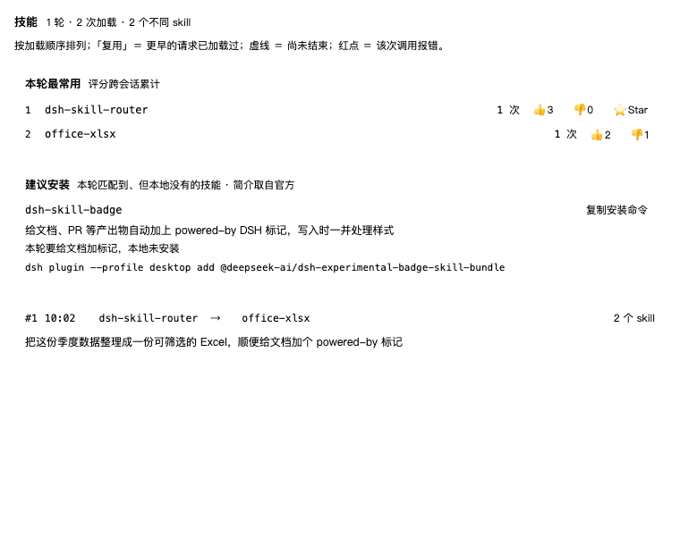
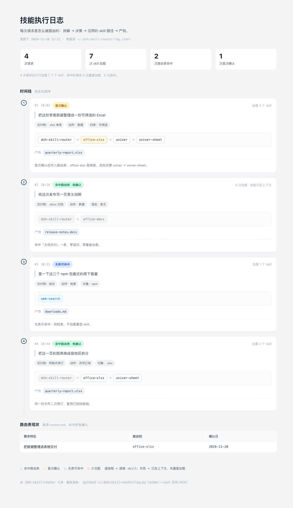

# dsh-skill-router

[English](README.md) | [简体中文](README.zh-CN.md) | [日本語](README.ja.md) | **한국어**

> **이 작업은 어떤 스킬이 맡아야 할까?** 한 번만 판단하고, 그 결론을 기억하고, 지나온 경로를 보여 줍니다.

[DeepSeek Harness](https://github.com/deepseek-ai/deepseek-harness)(DSH)에 스킬이 너무 많아 아무도 전부 파악할 수 없습니다. 처음 쓰는 사람은 어느 것을 골라야 할지 모르고, 익숙한 사람도 고른 스킬이 실제로 문제를 풀었는지 확신하기 어렵습니다.

이 번들은 그 판단을 명시적인 절차로 만듭니다 — 분해하고, 대조하고, 한 번만 확인한 뒤 재사용 — 그리고 대화 페이지에 **스킬** 뷰를 두어 지나온 경로를 눈에 보이게 합니다.

[`dsh-plugin`](https://github.com/topics/dsh-plugin) 생태계의 일부입니다 — 스킬, 패널, 설치기를 하나의 번들로.

## 구성

| 부분 | 역할 |
|---|---|
| `skills/dsh-skill-router/SKILL.md` | 라우팅 규칙: 요구를 분해하고, 스킬을 대조하고, 한 번 확인하고, 대응표를 기록하고, 경로를 남김 |
| `client.js` | 대화 페이지의 **스킬** 뷰: 턴마다 카드 하나로 실제 불러온 경로를 표시, 상단에 사용 횟수 상위 5개와 👍 / 👎 평가 |
| `assets/` | `routes.md` 템플릿과 `log.py`. 첫 설치 때 `$DSH_HOME/skill-router/`로 복사하며 기존 파일은 덮어쓰지 않음 |
| `index.js` | 호스트 측: `ctx.skills.registerProvider`로 스킬을 공개하고 상태 디렉터리를 초기화 |

## 데모

**스킬 뷰** — 대화 페이지의 「궤적」「컨텍스트」 옆에 붙습니다. 턴마다 카드 하나, 경로는 제목 줄에, 상단에는 이번 세션에서 가장 많이 쓴 스킬 5개와 누적 평가. *(샘플 데이터로 렌더링)*



**실행 로그** — `log.py render`가 `log.jsonl`을 단일 페이지로 바꿉니다. 요청마다 어떤 판단을 했고 어떤 스킬을 불러왔고 무엇이 나왔는지. *(샘플 데이터)*



## 라우팅 방식

1. **분해** — 산출물, 대상, 동작, 제약, 규모, 그리고 선택을 바꿀 수 있는 단 하나의 모호함.
2. **대조** — 세 가지 관문(그 산출물을 만들 수 있는가, 전제 조건이 갖춰졌는가, 금지된 용도가 아닌가)을 통과시킨 뒤 강 / 중 / 약으로 나눕니다. 약한 후보는 제시하지 않습니다.
3. **한 번만 확인** — 같은 종류의 요청에서 처음 한 번만.
4. **대응표에 기록** — `$DSH_HOME/skill-router/routes.md`에 "맞지 않는 용도" 경계까지 적어 나중에 잘못 발동하지 않게 합니다.
5. **재사용** — 같은 종류의 요청은 곧바로 스킬로. 설명 한 줄, 질문 없음.

## 설치

DSH `0.2.2` 이상이 필요합니다. **[최신 릴리스 내려받기](https://github.com/renzg/dsh-skill-router/releases/latest)**(`dsh-skill-router-0.5.1.tgz`) 후:

```bash
dsh plugin --profile desktop add dsh-skill-router-0.5.1.tgz
```

npm에서 설치하려면: `dsh plugin --profile desktop add @zhiyu.pub/dsh-skill-router`

**설정 → 플러그인 → 플러그인 추가**에서 tarball을 지정해도 됩니다. 직접 빌드하려면 저장소 루트에서 `npm pack`.

## 스킬 뷰

- 턴마다 카드 하나: `#n · 시각 · 경로 → · 개수`, 아래에 원래 요청.
- 경로 칩의 상태: 실선＝완료, 점선＝실행 중/결과 없음, 빨강＝오류, `复用`＝이전 턴에서 이미 불러옴.
- 상단: 이번 세션에서 가장 많이 쓴 스킬 5개와 브라우저 프로필별 누적 👍 / 👎.
- 평가는 스킬당 한 표: 같은 쪽을 다시 누르면 취소되고, 반대쪽을 누르면 옮겨집니다. `localStorage`에 저장되어 이 기기에서는 세션을 넘어 누적되지만 다른 기기로 따라가지 않습니다.
- 공식에는 있지만 설치되지 않은 스킬이 발견되면 응답에 보이지 않는 표식이 붙고, 패널에 **建议安装**(설치 제안) 행이 정확한 명령과 복사 버튼과 함께 나타납니다. 패널은 설치 상태를 읽을 수 없으므로 판정은 에이전트의 몫이고, 패널은 동작만 제공합니다.
- 👍을 누르면 저장소를 아는 스킬에 **⭐ Star** 링크가 나옵니다. 스타는 의도적인 한 번의 클릭입니다. 패널이 대신 GitHub에 쓰지는 않습니다.

## 상태 디렉터리

`$DSH_HOME/skill-router/`(기본 `~/.dsh/skill-router/`). 한 번만 만들고 덮어쓰지 않습니다.

```
routes.md    확정된 대응표
log.jsonl    라우팅 1건당 1줄
log.py       add / render 도우미
```

로그를 단일 페이지로:

```bash
python3 ~/.dsh/skill-router/log.py render --out ./skill-execution-log.html
```

## 개발

빌드 없음, 의존성 없음. 클라이언트 쪽은 `window.__ModuleLoader__`로 등록하는 평범한 모듈입니다.

```bash
node test/collect.test.mjs   # 폴딩 로직: 턴, 상태, 재사용
node test/render.test.mjs    # 렌더 스모크 테스트: 레이아웃, 평가, Star 링크, 빈 상태
```

변경 이력은 [CHANGELOG.md](CHANGELOG.md).

## 배포

태그를 만들고 저장소를 `dsh-plugin` 토픽에 등록합니다:

```bash
git tag -a v0.5.1 -m "dsh-skill-router 0.5.1" && git push origin v0.5.1
./scripts/set-topics.sh            # gh auth login 또는 GITHUB_TOKEN 필요
```

## 라이선스

MIT © 2026 renzg
