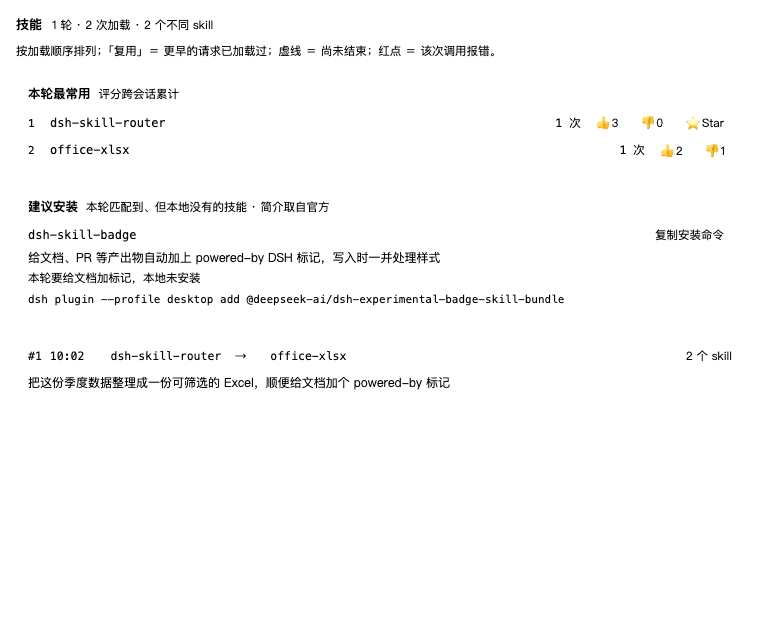
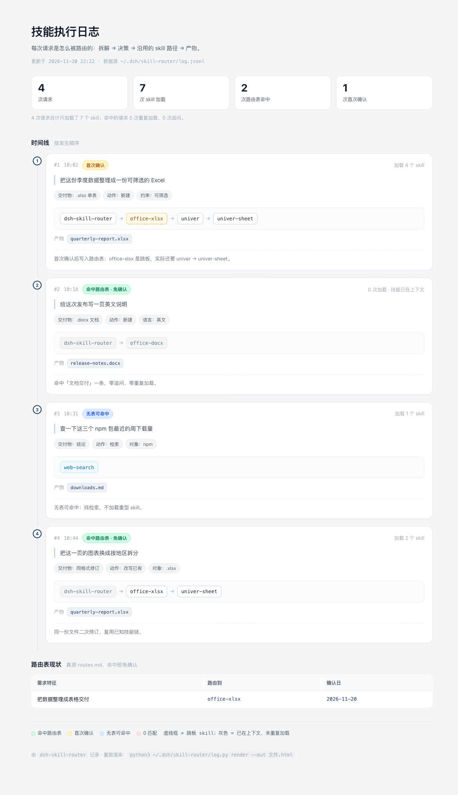

# dsh-skill-router

**English** | [简体中文](README.zh-CN.md)

A [DeepSeek Harness](https://github.com/deepseek-ai/deepseek-harness) (DSH) bundle that decides **which skill should handle a request**, asks you once, and remembers the answer.

Part of the [`dsh-plugin`](https://github.com/topics/dsh-plugin) ecosystem — skill, panel and installer in one bundle.

Two problems it solves: newcomers cannot tell which of the many installed skills fits a task, and experienced users cannot tell whether the skill they picked actually solves it. This bundle makes the decision explicit, then reuses it.

## What is in the bundle

| Part | Role |
|---|---|
| `skills/dsh-skill-router/SKILL.md` | The routing rules: decompose the request, match a skill, confirm once, write the mapping, log the path |
| `client.js` | A **Skills** view in the conversation page: one card per turn showing the skill path actually loaded, plus a top-5 panel with 👍 / 👎 ratings |
| `assets/` | `routes.md` template and `log.py`; copied into `$DSH_HOME/skill-router/` on first install, never overwriting |
| `index.js` | Host half: publishes the skill through `ctx.skills.registerProvider` and seeds the state directory |

## Demo

**Skills view** — drops into the conversation page next to Trajectory and Context. One card per turn, the skill path on the title row, and the five most-used skills of the session on top with cumulative ratings. *(rendered with sample data)*



**Execution log** — `log.py render` turns `log.jsonl` into a standalone page: every request, the decision it took, the skills it loaded and what came out. *(sample data)*



## How routing works

1. **Decompose** — artifact, object, verb, hard constraints, scale, the one ambiguity that could change the choice.
2. **Match** — three hard gates (can it produce this artifact, are its prerequisites available, does it forbid use here), then rank strong / medium / weak. Weak matches are not offered.
3. **Confirm once** — only on first use of a request class.
4. **Write the mapping** to `$DSH_HOME/skill-router/routes.md`, including a "not suitable for" boundary so the rule cannot over-fire later.
5. **Reuse** — next time the same class of request arrives, it goes straight to the skill, with one line of explanation and no question.

## Install

Requires DSH `0.2.2`. **[Download the latest release](https://github.com/renzg/dsh-skill-router/releases/latest)** (`dsh-skill-router-0.5.1.tgz`), then:

```bash
dsh plugin --profile desktop add dsh-skill-router-0.5.1.tgz
```

Or install from npm: `dsh plugin --profile desktop add @zhiyu.pub/dsh-skill-router`.

Or use **Settings → Plugins → Add plugin** and point it at the tarball. To build it yourself: `npm pack` in the repository root.

## The Skills view

- One card per turn: `#n · time · skill path → · count`, with the request underneath.
- Path chips show status: solid green settled, dashed running or unresolved, red errored, `复用` when the skill was already loaded by an earlier turn.
- Top block lists the five most-used skills of this session with cumulative 👍 / 👎 counts.
- Rating one click per skill per browser profile: clicking the same side withdraws the vote, switching sides moves it. Ratings live in `localStorage`, so they accumulate across sessions on this machine but do not follow you to another device.
- When routing finds a skill that exists officially but is not installed, the reply carries an invisible marker and the panel renders a **建议安装** row with the exact install command and a copy button. The panel cannot read your installed set, so the check itself is the agent's job; the panel only offers the action.
- After a 👍, a skill with a known repository shows a **⭐ Star** link. Starring itself is a deliberate click: the panel cannot write to GitHub on your behalf, and pretending otherwise would be worse than one honest click.

## State

`$DSH_HOME/skill-router/` (default `~/.dsh/skill-router/`), created once and never overwritten:

```
routes.md    your confirmed mappings
log.jsonl    one line per routed request
log.py       add / render helper
```

Render the log as a standalone page:

```bash
python3 ~/.dsh/skill-router/log.py render --out ./skill-execution-log.html
```

## Development

No build step, no dependencies. The client half is a plain module registered through `window.__ModuleLoader__`.

```bash
node test/collect.test.mjs   # folding logic: turns, statuses, reuse
node test/render.test.mjs    # render smoke: layout, ratings, star link, empty states
```

## Publish

Tag a release and list the repository under the `dsh-plugin` topic:

```bash
git tag -a v0.4.1 -m "dsh-skill-router 0.4.1" && git push origin v0.4.1
./scripts/set-topics.sh            # needs one `gh auth login` or GITHUB_TOKEN
```

## License

MIT © 2026 renzg
