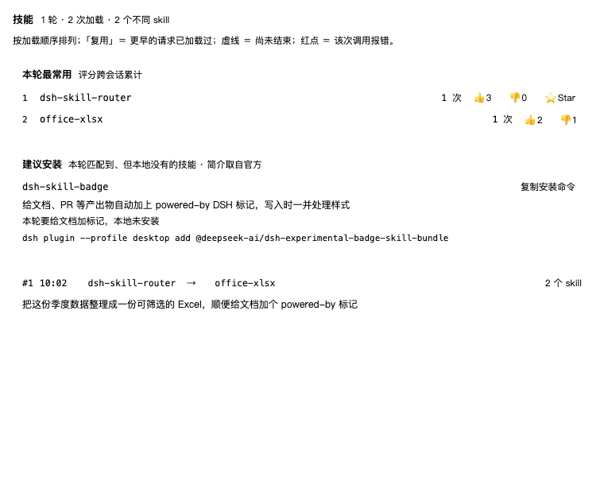
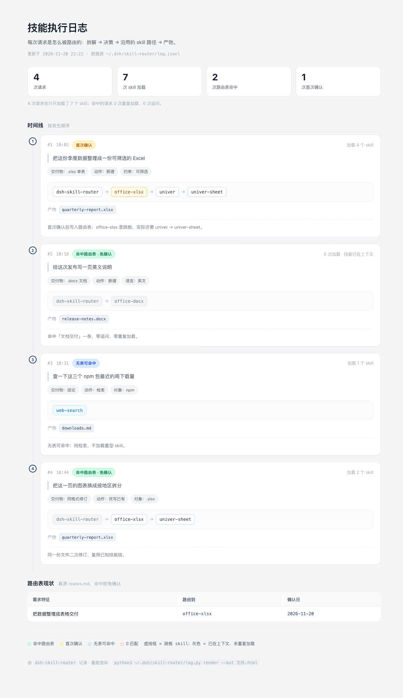

# dsh-skill-router

[English](README.md) | **简体中文**

一个 [DeepSeek Harness](https://github.com/deepseek-ai/deepseek-harness)（DSH）bundle：**先判断一个需求该由哪个 skill 来干**，首次问你一次，然后把结论记住。

属于 [`dsh-plugin`](https://github.com/topics/dsh-plugin) 生态 —— 一个 bundle 里装好技能、面板与安装器。

它解决两个问题：新手面对一堆 skill 不知道选哪个；老手不确定选中的 skill 是否真能解决问题。这个 bundle 把这次判断显式化，然后复用。

## 包里有什么

| 部分 | 作用 |
|---|---|
| `skills/dsh-skill-router/SKILL.md` | 路由规则本体：拆解需求、匹配 skill、一次确认、写入映射、记录路径 |
| `client.js` | 对话页里的「技能」视图：每轮一张卡，显示实际加载的 skill 路径；顶部 Top5 + 👍 / 👎 评价 |
| `assets/` | `routes.md` 模板与 `log.py`；首次安装时复制到 `$DSH_HOME/skill-router/`，不覆盖已有数据 |
| `index.js` | 宿主侧：通过 `ctx.skills.registerProvider` 发布技能，并初始化状态目录 |

## 演示

**「技能」视图** —— 挂在对话页 轨迹 / 上下文 旁边：每轮一张卡，路径在标题行，顶部是本轮最常用的 5 个 skill 与跨会话累计评价。（示例数据渲染）



**执行日志** —— `log.py render` 把 `log.jsonl` 变成独立页面：每次请求、做了什么决策、加载了哪些 skill、产出了什么。（示例数据）



## 路由怎么走

1. **拆解** —— 交付物、对象、动作、硬约束、规模，以及唯一那个会改变选择的歧义点。
2. **匹配** —— 三道硬门槛（能不能产出这种产物、前提条件是否具备、有没有明令禁止），再分强/中/弱。弱匹配不推荐。
3. **只确认一次** —— 同一个需求类型只在第一次问。
4. **写入映射** 到 `$DSH_HOME/skill-router/routes.md`，必须带「不适用」边界，防止日后误命中。
5. **复用** —— 下次同类需求直接开工，一句话说明，不再发问。

## 安装

要求 DSH `0.2.2`。先 **[下载最新发布](https://github.com/renzg/dsh-skill-router/releases/latest)**（`dsh-skill-router-0.5.1.tgz`），然后：

```bash
dsh plugin --profile desktop add dsh-skill-router-0.5.1.tgz
```

也可以直接从 npm 装：`dsh plugin --profile desktop add @zhiyu.pub/dsh-skill-router`。

或在 设置 → 插件 → 添加插件 里选择这个 tarball。想自己打：在仓库根目录跑 `npm pack`。

## 「技能」视图

- 每轮一张卡：`#n · 时间 · skill 路径 → · 数量`，下面一行是原始请求。
- 路径 chip 带状态：实线绿点＝已完成，虚线＝执行中/无结果，红点＝报错，`复用`＝更早的轮次已加载过。
- 顶部列出本轮最常用的 5 个 skill，附带跨会话累计的 👍 / 👎。
- 每个浏览器配置里，一个技能一票：再点同侧撤回，改点另一侧即改票。评分存在 `localStorage`，**跨会话累计，但换设备不跟随**。
- 当路由发现"官方有、本地没装"的技能时，回复里会带一段对用户不可见的标记，面板把它渲染成 **建议安装** 行，附准确的安装命令与复制按钮。面板读不到本地安装状态，所以「有没有装」由 agent 判断，面板只提供这个动作。
- 点 👍 后，若该 skill 有已知仓库，会出现 **⭐ Star** 链接。加星本身仍是一次该有的点击：面板无法代你写 GitHub，装作能写只会更糟。

## 状态目录

`$DSH_HOME/skill-router/`（默认 `~/.dsh/skill-router/`），只创建一次、从不覆盖：

```
routes.md    你确认过的映射
log.jsonl    每次路由一行
log.py       add / render 工具
```

把日志渲染成独立页面：

```bash
python3 ~/.dsh/skill-router/log.py render --out ./skill-execution-log.html
```

## 开发

无构建步骤、无依赖。客户端是 `window.__ModuleLoader__` 加载的普通模块。

```bash
node test/collect.test.mjs   # 折叠逻辑：轮次、状态、复用
node test/render.test.mjs    # 渲染冒烟：布局、评分、Star 链接、空态
```

版本变更见 [CHANGELOG.md](CHANGELOG.md)。

## 发布

打 tag，并把仓库挂到 `dsh-plugin` topic 下：

```bash
git tag -a v0.4.1 -m "dsh-skill-router 0.4.1" && git push origin v0.4.1
./scripts/set-topics.sh            # 需要一次 gh auth login 或 GITHUB_TOKEN
```

## 许可

MIT © 2026 renzg
